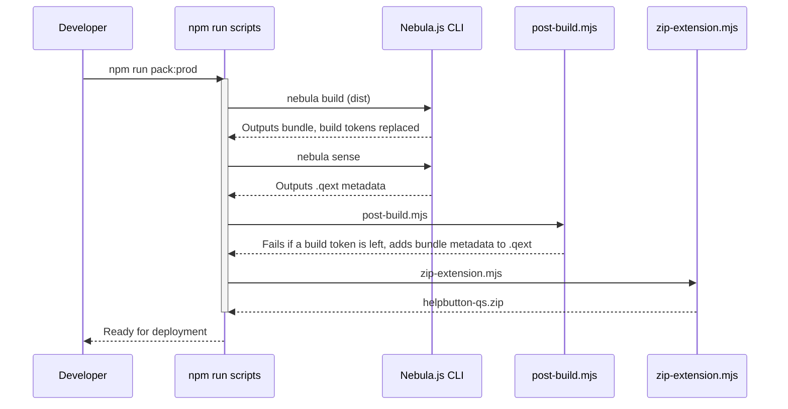

# helpbutton.qs Development Guide

This guide describes how the `helpbutton.qs` extension is built, tested, and distributed. The intended audience is developers who will be maintaining or extending the project.

## Prerequisites

- **Node.js 24**, version 24.15 or newer: The repository root includes `.nvmrc` with the expected major version, so `nvm use` from anywhere inside the repo selects the supported runtime.
- **Install command**: Use `PUPPETEER_SKIP_DOWNLOAD=true npm ci` from the repository root before running the build, lint, or packaging commands documented below.

## Project Structure

The extension uses ES modules and is built around **Nebula.js**. It consists of several key architectural components:

- **Nebula Component Hooks (`src/index.js`)**: The standard functional entry point utilizing `useElement`, `useLayout`, `useOptions`, and `useEffect` to coordinate between edit and analysis mode workflows.
- **Platform Adaptation (`src/platform/`)**: Provides abstraction on top of Qlik Cloud and Qlik Sense Client-Managed versions, addressing differing DOM structures to integrate seamlessly onto the toolbar.
- **Toolbar Injector (`src/ui/toolbar-injector.js`)**: Escapes the standard container scope by binding directly to the Qlik application header.
- **Context Interceptor (`src/util/template-fields`)**: Intercepts app-specific context variables such as `{{appId}}` to create dynamic help links.
- **Property Panel (`src/ext.js`)**: Defines the configuration options visible in the Qlik Sense property panel.

## Common Scripts commands

Below is a breakdown of the available `npm run` commands:

### Development and Local Serve

| Command         | Description                                                                                                                                       |
| --------------- | ------------------------------------------------------------------------------------------------------------------------------------------------- |
| `npm run start` | Starts a local development server using `nebula serve`, with the build options in `nebula.config.cjs` (see [Build tokens](#build-tokens)).        |
| `npm run build` | Runs a development build using Nebula CLI (`nebula build`). Sets the `BUILD_TYPE` environment variable to `development` and disables source maps. |

### Build and Packaging

| Command              | Description                                                                                                                             |
| -------------------- | --------------------------------------------------------------------------------------------------------------------------------------- |
| `npm run build:dist` | Runs a production build (`nebula build`).                                                                                               |
| `npm run sense`      | Generates the Qlik Sense metadata and the `.qext` file from `src` using `nebula sense`.                                                 |
| `npm run zip`        | Runs `scripts/zip-extension.mjs`: zips the extension folder. Fails, leaving no zip, with no `.qext` or on an archiver error or warning. |
| `npm run post-build` | Runs `scripts/post-build.mjs`: fails on a build token left in a bundle, then adds bundle metadata to the `.qext`, failing if it cannot. |

### Recommended End-to-End Pack Commands

For creating a drop-in ready extension, these composite scripts bundle everything seamlessly:

- `npm run pack:dev`: Runs the full lifecycle in development mode (`build -> sense -> post-build -> zip`).
- `npm run pack:prod`: Runs the full lifecycle in production mode (`build:dist -> sense -> post-build -> zip`).

### Quality Control

| Command                                   | Description                                                                                                                           |
| ----------------------------------------- | ------------------------------------------------------------------------------------------------------------------------------------- |
| `npm run lint` / `npm run lint:fix`       | Runs ESLint on `src` and `scripts` directories.                                                                                       |
| `npm run format` / `npm run format:check` | Runs Prettier to enforce code styling on all files.                                                                                   |
| `npm test`                                | Runs the `*.test.js` Vitest unit tests in `src` and `scripts`. CI runs them, with lint and the Prettier check, on every pull request. |

### Pre-Commit Hooks

This project uses [Husky](https://typicode.github.io/husky/) to enforce quality checks automatically before each commit. Running `npm install` or `npm ci` runs the `prepare` script, which installs a pre-commit hook that:

1. Runs `lint-staged` to format and lint staged files.
2. Runs `gitleaks protect -v --staged` to scan for accidentally committed secrets (only if `gitleaks` is installed locally).

If you install dependencies with `--ignore-scripts`, run `npm run prepare` manually to set up the hook.

If `gitleaks` is not installed, the hook prints a warning and continues without failing. To install `gitleaks`, see the [official installation guide](https://gitleaks.io/documentation/getting-started/installation/).

## Build Workflow

## Build tokens

`src/util/logger.js` reads three names that only the build can fill in: `__BUILD_TYPE__`, `__PACKAGE_VERSION__` and `__BUILD_DATE__`. The About dialog and the About section of the property panel show the version and the build date, and the build type turns debug logging off in production builds. `scripts/build-tokens.cjs` lists the names and works out each one's value.

While nebula builds, Rollup's replace plugin puts each value in its place, before terser minifies the production bundle. nebula reads the `build` section of `nebula.config.cjs` as its command-line options, and never reads a key it does not know: it gives no error and no warning. So the file can only set options that nebula has. The tokens go in `replacementStrings`, the one option that nebula hands to its replace plugin. Every npm script that runs `nebula build` or `nebula serve` names the file with `--config nebula.config.cjs`. Without it, nebula looks for `nebula.config.js`, finds none, and builds with no options at all.

From the first commit until November 2026 the file held two keys that nebula never read: `replacement`, and a `rollup()` hook, which no nebula version this repository has used (6.6 to 7.9) calls. So Rollup replaced no token, in any build. `scripts/post-build.mjs` patched them into the finished bundles instead, and `npm start`, which runs no post-build step, served a bundle that still held all three. Now post-build replaces nothing. It fails the build if a token is left in a bundle, so a replacement that stops working shows at once.

`scripts/nebula-config.test.js` fails on a `build` key that nebula does not read, on a script that runs nebula without the file, and when the replace plugin of nebula's own Rollup configuration leaves a token in `src/util/logger.js`. `scripts/post-build.test.js` checks that post-build fails, and patches nothing, when a token is left in a bundle or `dist/` holds no bundle.

## Additional Technical Context

- **DOM Escape Mechanism:** Because the extension sits in the global header, it requires a robust DOM manipulation handler to attach itself without polluting ongoing React/Angular digest cycles in Qlik applications.
- **Singleton Lifecycle**: A `destroyHelpButton()` method in the cleanup effect tears down the toolbar listener when the user navigates away from the sheet or when the context object unmounts.
- **Menu Suppression:** The property panel provides configuration that utilizes JavaScript event interceptors and `MutationObserver` routines to effectively hide standard grid cell menus or Cloud React portals, leaving the item functionally invisible.
